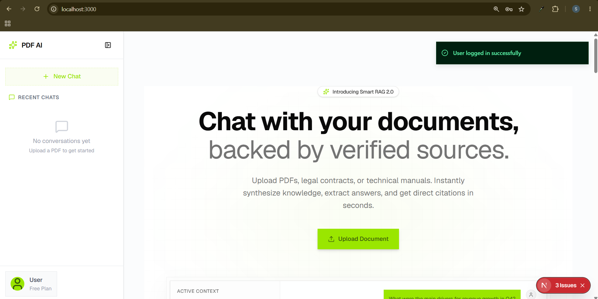
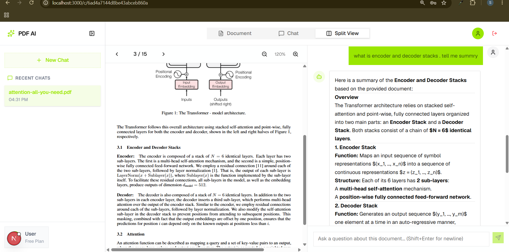
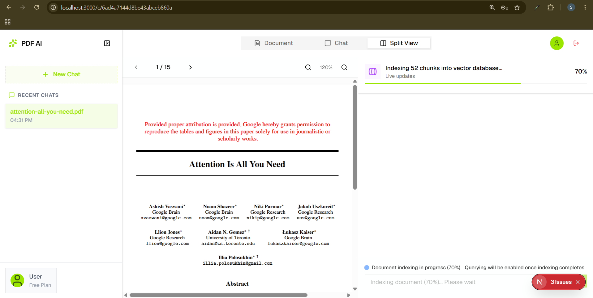
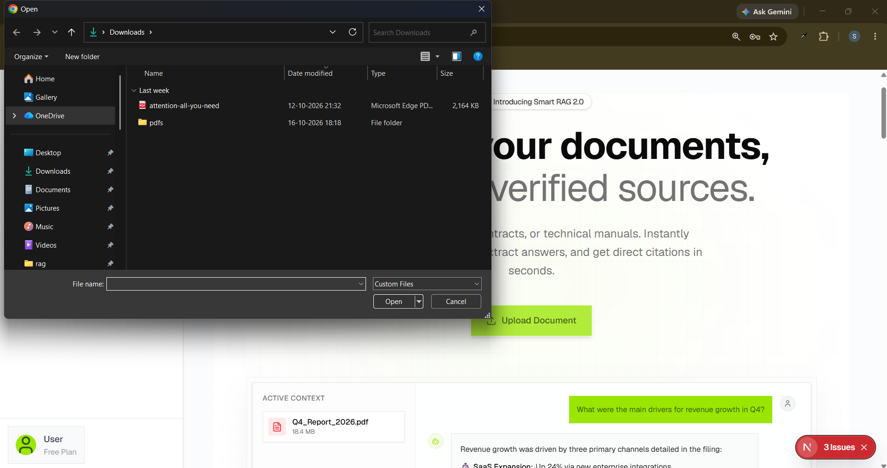
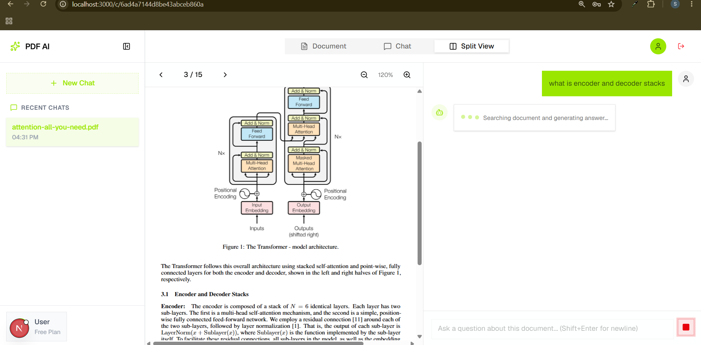
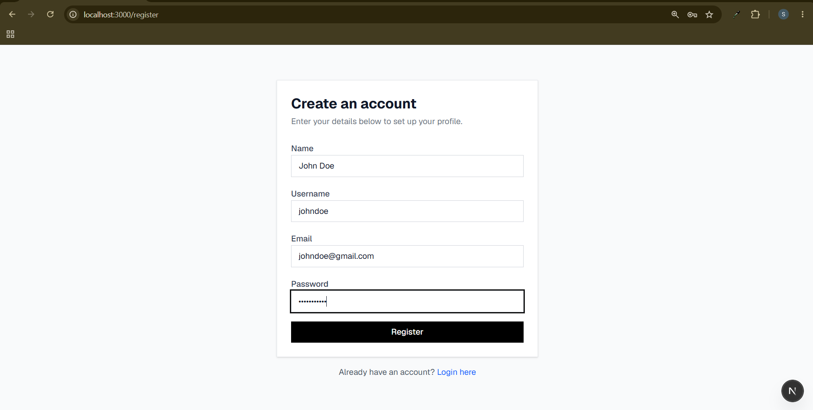
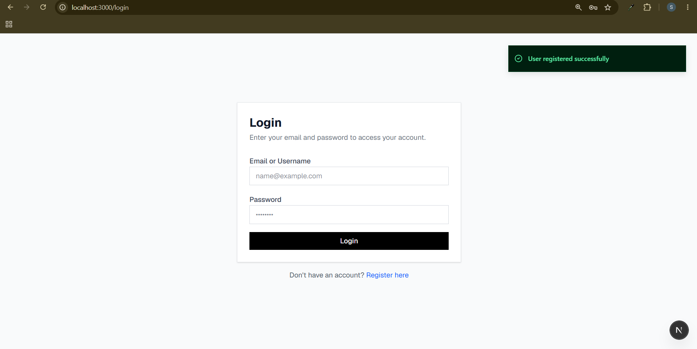
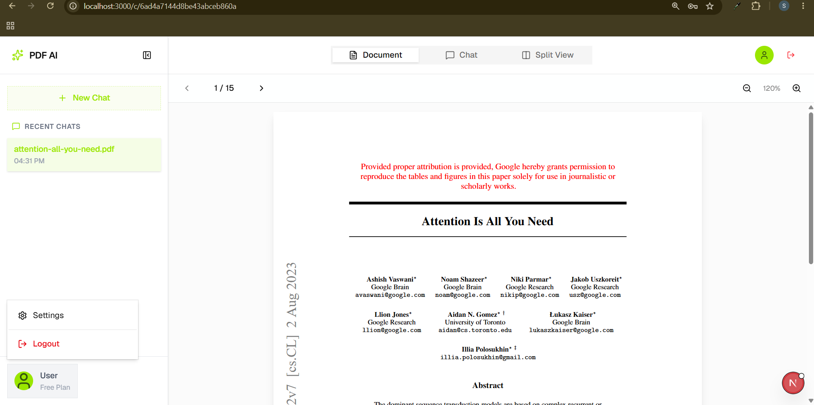
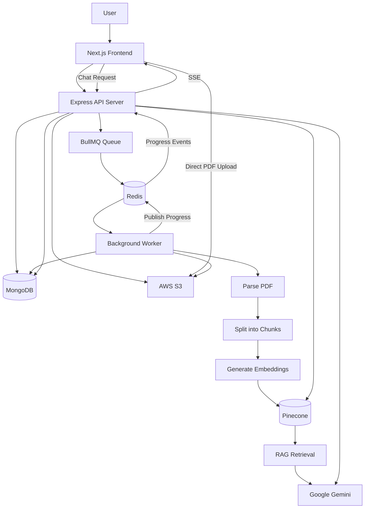

# PDF Chat — AI-Powered Document Chat Webapp

An AI-powered PDF chat application that allows users to upload PDF documents and ask questions about their content using Retrieval-Augmented Generation (RAG).

The application processes uploaded documents asynchronously, converts them into searchable vector embeddings, and retrieves relevant context to generate answers with an LLM.

## Overview

PDF Chat makes it easier to understand long documents without manually searching through hundreds of pages.

Users can upload a PDF, wait for document processing to complete, and start asking questions in natural language. The application retrieves relevant document chunks and uses them as context for generating responses.

## Screenshots

### Home Page


### PDF Chat Interface


### Document Processing


### Upload PDF


### Answer Generation via Streaming


### User Registration


### User Login


### User Logout



### Key Features

- **PDF Upload:** Upload PDF documents using secure, presigned S3 upload URLs.
- **AI-Powered Conversations:** Ask questions about uploaded documents in natural language.
- **Retrieval-Augmented Generation:** Retrieve relevant document chunks before generating answers.
- **Asynchronous Processing:** Process documents in background workers instead of blocking API requests.
- **Real-Time Ingestion Progress:** Track document-processing stages through server-sent events (SSE) and Redis Pub/Sub.
- **Vector Search:** Store and retrieve document embeddings using Pinecone.
- **Conversation History:** Persist conversations and messages for continued access.
- **Private Documents:** Associate documents and conversations with their owners.
- **Reliable Job Processing:** Use BullMQ retries and exponential backoff for failed ingestion jobs.
- **Scalable Architecture:** Run the API server and background worker as separate processes.

## Tech Stack

| Category | Technology |
|---|---|
| Frontend | Next.js, React, TypeScript | Shadcn UI| Framer Motion | React PDF | Zustand | axios |
| Backend API | Node.js, Express.js, TypeScript | Zod | 
| Database | MongoDB, Mongoose |
| LLM | Google Gemini |
| RAG Framework | LangChain |
| Vector Database | Pinecone |
| Embeddings | Configured embedding model |
| Background Jobs | BullMQ |
| Queue and Pub/Sub | Redis |
| Object Storage | AWS S3 |
| PDF Delivery | Amazon CloudFront |
| Validation | Zod |
| Development | Git, npm |

## Architecture



## How It Works

### 1. PDF Upload

1. The user selects a PDF from the frontend.
2. The frontend requests an upload URL from the backend.
3. The backend creates the required document metadata and generates a presigned S3 upload URL.
4. The frontend uploads the PDF directly to S3.
5. After a successful upload, the frontend calls the backend to confirm the upload and initiate ingestion.
6. The backend enqueues a document-processing job in BullMQ.

Direct-to-S3 uploads reduce the amount of file data passing through the API server.

### 2. Document Ingestion

A background worker processes the document asynchronously.

The pipeline consists of the following stages:

1. **Download:** Retrieve the uploaded PDF from S3.
2. **Parse:** Extract text from the PDF.
3. **Chunk:** Split the extracted text into smaller, overlapping text chunks.
4. **Embed:** Convert each chunk into a vector representation using the configured embedding model.
5. **Index:** Store the vectors and associated metadata in Pinecone.
6. **Update Status:** Persist the final processing status in MongoDB.

Document processing follows a lifecycle such as:

`UPLOADED → QUEUED → DOWNLOADING → PARSING → SPLITTING → INDEXING → READY`

If processing fails, the job can be retried according to the configured BullMQ retry policy.

### 3. Real-Time Processing Progress

Document ingestion can take time, especially for large PDFs. The frontend therefore displays the current processing stage instead of leaving the user with an indefinite loading screen.

The flow is:

1. The worker updates the ingestion stage.
2. The worker publishes progress events through Redis Pub/Sub.
3. The API server forwards those events to the frontend through SSE.
4. The frontend updates the progress indicator.
5. When ingestion succeeds, the chat interface becomes available.

Redis Pub/Sub provides event delivery between the worker and API processes. Persisted document status should remain the source of truth because Pub/Sub messages are not durable and subscribers can miss events while disconnected.

### 4. Question Answering with RAG

When the user submits a question:

1. The frontend sends the question and conversation identifier to the backend.
2. The backend verifies access to the conversation and its associated document.
3. The question is converted into an embedding using the compatible embedding model.
4. Pinecone retrieves the most relevant document chunks.
5. The backend builds a prompt containing the question and retrieved context.
6. Google Gemini generates an answer grounded in the retrieved context.
7. The response and conversation history are persisted and returned to the frontend.

The RAG workflow can be summarized as:

`Question → Embedding → Vector Retrieval → Context Construction → LLM Generation → Answer`

Retrieval metadata can be used to associate answers with relevant document pages or chunks when that information is available.

## Project Structure

The repository separates the frontend from the backend. The backend contains both the HTTP API and the background worker, which run as separate processes.

```text
pdf-chat-rag/
├── client/
│   ├── src/
│   │   ├── app/
│   │   ├── components/
│   │   ├── hooks/
│   │   ├── lib/
│   │   └── services/
│   └── package.json
│
├── server/
│   ├── src/
│   │   ├── config/
│   │   ├── controllers/
│   │   ├── middleware/
│   │   ├── models/
│   │   ├── routes/
│   │   ├── services/
│   │   ├── utils/
│   │   └── worker/
│   ├── package.json
│   └── tsconfig.json
│
├── .gitignore
└── README.md
```


## Getting Started

### Prerequisites

Install or configure the following:

- Node.js and npm
- MongoDB
- Redis
- AWS account with an appropriately configured S3 bucket
- Pinecone account and index
- Google Gemini API key

### 1. Clone the Repository

```bash
git clone https://github.com/codingwalebhaiya/rag-chat-app
cd rag-chat-app
```

### 2. Configure the Backend

```bash
cd server
npm install
```

Create a `.env` file inside `server/`:

```env
NODE_ENV=development
PORT=8000

MONGO_URI=mongodb://127.0.0.1:27017/pdf-chat-rag

FRONTEND_URL=http://localhost:3000
JWT_ACCESS_SECRET_KEY=your_jwt_access_secret_key
JWT_REFRESH_SECRET_KEY=your_jwt_refresh_secret_key
GEMINI_API_KEY=your_gemini_api_key

PINECONE_API_KEY=your_pinecone_api_key
PINECONE_INDEX=your_pinecone_index_name

AWS_REGION=your_aws_region
AWS_ACCESS_KEY_ID=your_aws_access_key
AWS_SECRET_ACCESS_KEY=your_aws_secret_key
AWS_S3_BUCKET_NAME=your_bucket_name

CLOUDFRONT_DOMAIN=your_cloudfront_domain
CLOUDFRONT_PRIVATE_KEY=your_cloudfront_private_key
CLOUDFRONT_KEY_PAIR_ID=your_cloudfront_key_pair_id
UPSTASH_REDIS_URL=your_redis_connection_url
```

Use the actual environment variable names expected by your application. The names above are examples and should be aligned with your Zod environment schema.

### 3. Start the Backend API

```bash
npm run dev
```

The API should be available at:

`http://localhost:8000`

### 4. Start the Background Worker

Open a second terminal:

```bash
cd server
npm run worker
```

The worker must have access to the same MongoDB, Redis, AWS, Pinecone, and embedding-model configuration required by the ingestion pipeline.

### 5. Configure and Start the Frontend

Open another terminal:

```bash
cd client
npm install
```

Create the frontend `.env.local` file using the environment variable name expected by your frontend:

```env
NEXT_PUBLIC_API_URL=http://localhost:8000/api/v1
```

Then start the development server:

```bash
npm run dev
```

Open `http://localhost:3000` in your browser.

**Note:** Ensure MongoDB and Redis are running, your AWS permissions are configured correctly, and your Pinecone index uses the same embedding dimensions and model configuration as your ingestion pipeline.

## API Overview

The following table describes the intended API responsibilities. Replace example paths with the actual routes implemented in the project.

| Method | Example Endpoint | Purpose |
|---|---|---|
| POST | `/api/v1/files/presigned-url` | Generate a presigned upload URL |
| POST | `/api/v1/files/confirm-upload` | Confirm upload and enqueue ingestion |
| GET | `/api/v1/files/file-ingestion-progress/:conversationId` | Stream ingestion progress using SSE |
| POST | `/api/v1/conversations/:conversationId/query` | submit a question and generate an answer |
| GET | `/api/v1/conversations/:conversationId` | Retrieve conversation history |
| GET | `/api/v1/conversations` | get all conversations |
| DELETE | `/api/v1/conversations/:conversationId` | delete a conversation |
| POST | `/api/v1/auth/register` | Register a new user |
| POST | `/api/v1/auth/login` | Login a user |
| POST | `/api/v1/auth/logout` | Logout a user |
| POST | `/api/v1/auth/refresh-token` | Refresh the access token |
| GET | `/api/v1/auth/profile` | Get the user profile |
 

## Security Considerations

- Keep API keys and cloud credentials on the server.
- Never expose AWS secret keys, Gemini API keys, or Pinecone API keys to the frontend.
- Use presigned URLs with short expiration times and restrict upload permissions.
- Validate file type, file size, and upload ownership on the backend.
- Authorize access to every document and conversation using the authenticated user's identity.
- Apply tenant-aware filtering to vector searches.
- Validate request bodies and environment variables.
- Restrict CORS to trusted frontend origins.
- Use private S3 objects and an appropriate CloudFront access-control strategy.
- Avoid logging secrets, signed URLs, or sensitive document contents.
- Configure rate limits and usage limits for uploads and AI requests.

## Reliability and Scalability

The API and worker are separate processes, allowing them to scale independently.

- **BullMQ:** Provides queued background jobs, retries, and backoff.
- **Redis:** Supports job coordination and transient progress-event delivery.
- **MongoDB:** Stores document metadata, processing status, and conversations.
- **Pinecone:** Supports similarity search over indexed document chunks.
- **S3:** Stores PDF files independently of API server memory and disk.

For production deployments, consider idempotent ingestion jobs, cleanup of partially indexed documents, queue monitoring, dead-letter or failed-job handling, per-user rate limits, and metrics for processing latency and token usage.

## Deployment

The application can be deployed using separate services for the frontend, API, and worker.

A possible deployment setup is:

- **Frontend:** Vercel
- **API server:** Render or another Node.js hosting platform
- **Worker:** A separate background service
- **Database:** MongoDB Atlas
- **Redis:** Upstash Redis or another compatible Redis provider
- **File storage:** Amazon S3
- **PDF delivery:** Amazon CloudFront
- **Vector database:** Pinecone

Before deployment, configure production environment variables, CORS, S3 permissions, CloudFront access, Redis connectivity, health checks, and worker restart policies.

Confirm that your chosen Redis service supports the BullMQ features and connection behavior your application requires.

## Future Improvements

- Source citations with clickable PDF page references
- Hybrid search combining semantic and keyword retrieval
- Improved retrieval through reranking
- Conversation memory and follow-up question handling
- Document deletion and vector-index cleanup
- Support for multiple documents per conversation
- Usage tracking and per-user quotas
- Automated tests and CI/CD
- Production monitoring and error reporting

## Learning Outcomes

This project demonstrates practical experience with:

- Full-stack application development using TypeScript
- REST API design and database integration
- Retrieval-Augmented Generation and vector search
- PDF parsing, chunking, and embeddings
- Background processing with Redis and BullMQ
- Event-driven progress updates using Redis Pub/Sub and SSE
- Cloud object storage and secure file delivery
- Authentication, authorization, and multi-tenant data isolation
- Deployment and production reliability considerations

## License

This project is available under the [MIT License](LICENSE).

---

**Built as a full-stack AI project to explore document question answering, RAG pipelines, background processing, and production-oriented application architecture.**
